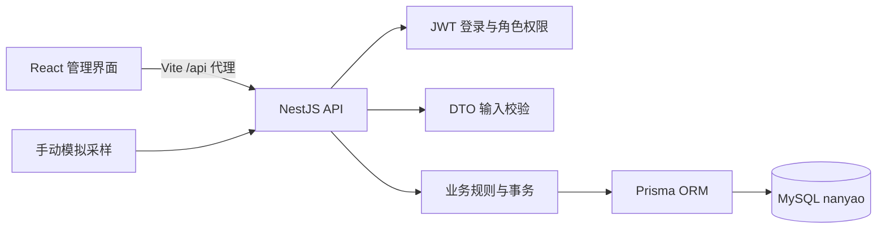
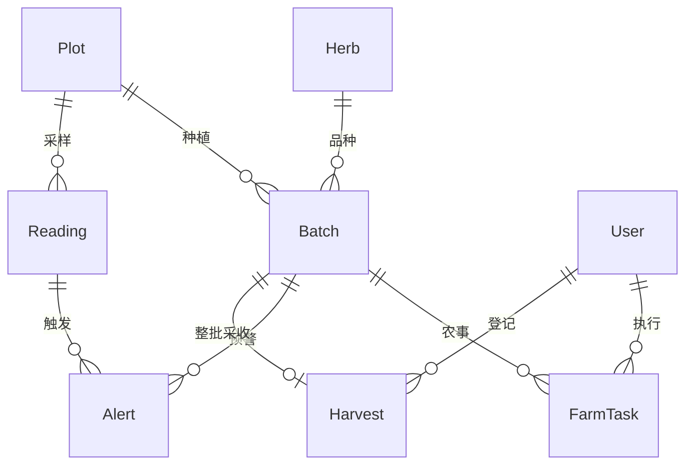
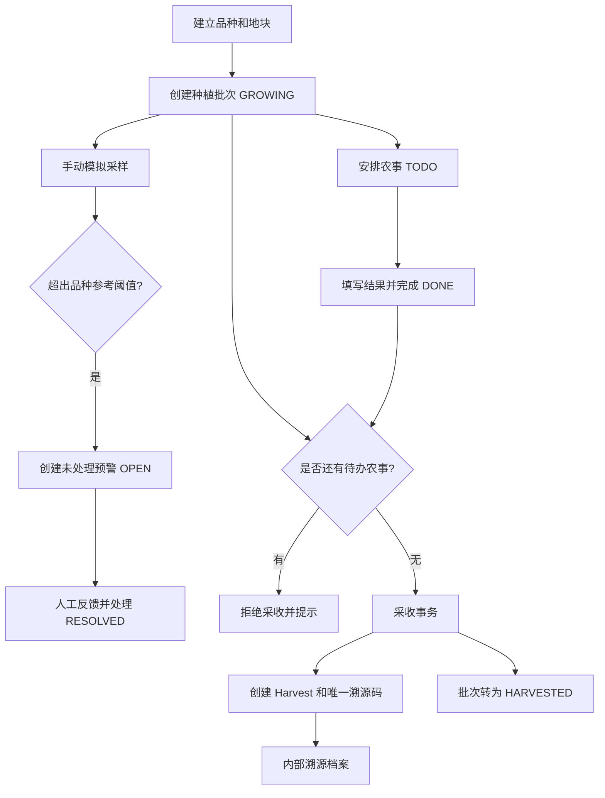

# 南药智慧种植平台设计说明

## 架构

React 使用 Ant Design 表单与表格、ECharts 趋势图和占比图。NestJS 负责身份验证、权限、关联与日期校验。MySQL 保存全部业务记录，页面刷新不会丢失已保存数据。

前端 JWT 保存在当前标签页的 `sessionStorage`；令牌期限为 8 小时。后端每次校验当前用户存在且角色符合要求。密码使用 bcrypt 散列，不返回给浏览器。

## 数据关系

| 表 | 主要内容 |
|---|---|
| User | 账号、散列密码、姓名、角色 |
| Herb | 名称、学名、科属、部位、产区、生长周期、温湿度阈值 |
| Plot | 名称、面积、位置、土壤、负责人 |
| Batch | 唯一编号、品种与地块、种植/预计采收时间、数量、状态 |
| FarmTask | 类型、批次、执行人、期限、状态、实际结果 |
| Reading | 地块、温度、空气湿度、土壤湿度、光照、模拟标记、采样时间 |
| Alert | 对应批次与采样、指标、描述、处理状态与记录 |
| Harvest | 唯一批次、唯一溯源码、时间、重量、内部分级、去向、登记人 |

Batch 与 Harvest 一对零或一，实现整批采收约束。外键使用 Restrict，保留已形成的业务链条。FarmTask、Reading、Alert 按常用检索字段建立索引。

## 业务状态

监测仅判断空气温度与土壤湿度，空气湿度和光照目前用于展示。常规采样以该地块首个在种品种的区间中值附近生成；同地块若种植多种南药，会按每个批次各自阈值判断，不承诺对所有品种都“正常”。

采收使用 Serializable 事务，事务内校验批次与待办、创建采收记录并更新批次状态。并发冲突向调用方返回 409，要求刷新重试。未处理预警去重也在事务内执行。

## API

统一前缀 `/api`。除登录外均需 `Authorization: Bearer <token>`。请求与响应使用 JSON；日期为 ISO 8601。PUT 档案接口提交完整字段，不是局部 PATCH。

| 方法 | 路径 | 用途 | 写入权限 |
|---|---|---|---|
| POST | /auth/login | 用户名密码登录 | 无需登录 |
| GET | /auth/me | 当前账号 | 已登录 |
| GET | /auth/users | 可分配人员（不含密码） | 已登录 |
| GET | /dashboard | 基地统计、待办、预警、在种批次 | 已登录 |
| GET / POST | /herbs | 品种列表 / 创建 | 创建限管理员 |
| PUT / DELETE | /herbs/:id | 更新 / 删除品种 | 管理员 |
| GET / POST | /plots | 地块列表 / 创建 | 创建限管理员 |
| PUT / DELETE | /plots/:id | 更新 / 删除地块 | 管理员 |
| GET / POST | /batches | 批次列表 / 创建 | 创建限管理员 |
| PUT / DELETE | /batches/:id | 更新 / 删除批次 | 管理员 |
| GET / POST | /tasks | 农事列表 / 安排农事 | 安排限管理员 |
| PATCH | /tasks/:id/complete | 填写 result 并完成 | 被分配人或管理员 |
| GET | /monitoring | 各地块最近 24 次采样 | 已登录 |
| POST | /monitoring/simulate | plotId、scenario 模拟采样 | 管理员 |
| GET | /alerts | 预警列表 | 已登录 |
| PATCH | /alerts/:id/resolve | 填写 resolution 并处理 | 已登录 |
| GET / POST | /harvests | 采收列表 / 整批采收 | 已登录 |
| GET | /trace/:code | 内部溯源查询 | 已登录 |

错误状态：400 输入不合法；401 未登录/令牌过期；403 权限不足；404 记录不存在；409 重复、关联保护、已完成状态或并发冲突。服务器不把数据库内部错误明细暴露给客户端。

## 本次范围

不包含真实 IoT、远程设备控制、AI 诊断、公开互联网部署、短信推送、采购销售、区块链、防篡改证书、多租户或复杂组织权限。

用户管理目前提供两种演示角色和人员读取，不提供注册或后台新增账号界面。环境采样由管理员手动触发，不设置定时采集进程。列表适合课设规模，前端执行搜索和分页；大规模生产系统需要另行设计后端分页及归档。
